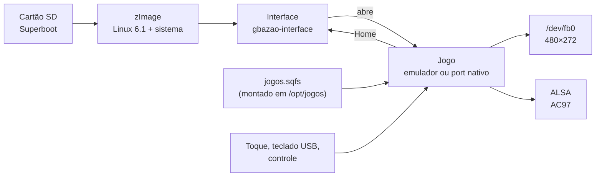

<div align="center">

# GBAZÃO

**Um console portátil feito a partir de uma placa ARM antiga que tinha sido descartada.**


Trabalho de Conclusão de Curso · Engenharia de Computação · PUCRS

</div>

---

O GBAZÃO pega uma **FriendlyARM Mini6410** (Samsung S3C6410, ARM1176 a 532 MHz, 256 MB de
RAM, tela de toque de 4.3") e a transforma num console portátil inspirado no Game Boy
Advance, só que bem maior (daí o nome). Tudo roda num Linux mínimo feito sob medida, que
liga direto numa interface própria com jogos de GBA e jogos nativos de PC portados para a
placa.

A ideia é mostrar que um hardware considerado obsoleto pode ser reaproveitado e transformado em algo útil.

## O que tem

- **Sistema próprio:** Linux 6.1 com Buildroot, *kernel* e sistema inteiro num único
  arquivo de 9,4 MB, com patches próprios para a tela, o toque, o áudio, o USB e o relógio da
  placa.
- **Interface de console:** carrossel de blocos, grade de jogos com capas, configurações
  (brilho, volume, escala, contador de FPS), menu rápido sobre qualquer jogo, botão Home,
  pendrive, modo avançado com terminal. Tudo desenhado direto no *framebuffer*.
- **Emulador de Game Boy Advance:** núcleo gpSP com um *frontend* próprio, savestates,
  jogos salvos e pulo de quadros guiado pelo som. Roda a 60 quadros/s.
- **Jogos nativos portados:** Doom, Quake, Spelunky, Cave Story, OpenTyrian, Abuse,
  Wolfenstein 3D e SuperTux, cada um com o menu rápido e o Home do console.
- **Camada SDL2 → GBAZÃO:** jogos que usam SDL2 rodam sem mudar o código deles; a camada
  troca a janela, o desenho e a entrada pelas do console.
- **Simulador no PC:** a interface e todos os jogos compilam também para o PC, a partir dos
  mesmos fontes, para desenvolver sem a placa.
- **Carcaça para impressão 3D:** modelo feito em FreeCAD, ainda em fases iniciais de desenvolvimento.

## Jogos

Medidos na placa, nas telas de título e demonstrações.

| Jogo | Motor | Abre em | Quadros/s |
|---|---|---|---|
| Game Boy Advance | gpSP + *frontend* próprio | 2 s | 59 |
| Spelunky | SpelunkyPSP + OpenGL em software próprio | 3 s | 59 |
| Doom (Freedoom) | doomgeneric | 1 s | 35 (o máximo do Doom) |
| Cave Story | NXEngine-evo | 2 s | 21 |
| Quake (LibreQuake) | quakegeneric | 1 s | 18 |
| OpenTyrian | OpenTyrian, pela camada SDL2 | 7 s | 18 |
| Abuse | Abuse SDL2, pela camada SDL2 | 3 s | 15 |
| Wolfenstein 3D | Wolf4SDL, pela camada SDL2 | 10 s | a medir em partida |
| SuperTux Milestone 1 | SuperTux SDL2, pela camada SDL2 | 76 s | 3 (ainda não jogável) |

Os **dados dos jogos não fazem parte do repositório**: cada um vem da fonte oficial (veja
[Dados dos jogos](#dados-dos-jogos)). Jogos comerciais nunca são distribuídos.

## Como funciona



- O **Superboot** da placa carrega o `zImage` do cartão SD sem tocar na memória NAND (por enquanto, no futuro ainda vou tentar usar a própria NAND).
- O `zImage` traz o *kernel* e o sistema inteiro (BusyBox, interface, bibliotecas),
  compactados em LZ4, que descompacta rápido no ARM11.
- Os jogos ficam fora do *kernel*, numa imagem **squashfs** no cartão, montada no boot. Assim
  o `zImage` fica abaixo do limite do carregador (cerca de 10,3 MB) e os jogos crescem sem
  afetar o boot.
- A interface é o processo principal: ao abrir um jogo, solta a tela, o som e a entrada,
  espera o jogo terminar e volta à frente.
- Cada port tem uma camada fina que liga o motor do jogo à tela, aos botões, ao menu rápido
  e ao contador de FPS do console, com o mesmo código para a placa e para o simulador.

### Boot

| Etapa | Tempo |
|---|---|
| `/init` começa (relógio do *kernel*) | 1,75 s |
| Interface começa | 3,34 s |
| Memória usada com a interface aberta | 17 MB de 246 MB |

## Controles

O controle definitivo (botões ligados aos pinos da placa) ainda está em prototipagem. Enquanto
isso, tudo funciona com um teclado USB:

| Botão | Menus | GBA e Spelunky |
|---|---|---|
| Direcional | setas | setas |
| A / B | Enter / Esc | X / Z |
| L / R | Page Up / Page Down | A / S |
| Start / Select | Espaço / Tab | Enter / Backspace |
| Menu rápido | F1 | F1 ou Esc |
| Home | F2 ou Home | F2 ou Home |

Nos jogos de PC (Doom, Quake, Cave Story, Wolfenstein 3D e os outros), o teclado funciona
como no jogo original, com **F12** para o menu rápido e **Home** para sair.

## Estrutura

```
sistema/
  buildroot/    árvore externa do Buildroot: configuração, pacotes próprios, patches do kernel
  interface/    interface do console (C, SDL2 só para desenhar em memória)
  kernel/       drivers e geradores dos patches da placa
  simulador/    compilação da interface e dos jogos para o PC
  ferramentas/  instalar pela rede, montar o cartão, testar a placa
software/
  emulador/     frontend do GBA (gpSP)
  sdl_gbazao/   camada SDL2 -> GBAZÃO
  doom/ quake/ spelunky/ cavestory/ tyrian/ abuse/ wolf3d/ supertux/
hardware/
  carcaca/      modelo da carcaça (FreeCAD)
documentacao/   pinagem, guias etc
medicoes/       medidas feitas na placa
texto/          monografia do TCC
```

## Compilando

Testado no Ubuntu (WSL2). Precisa das dependências usuais do
[Buildroot](https://buildroot.org/downloads/manual/manual.html#requirement).

```bash
# sistema completo para a placa (kernel, interface, jogos)
sh sistema/buildroot/compilar.sh
```

O resultado fica em `output-mini6410/images/`: `zImage` e `jogos.sqfs`.

```bash
# interface e jogos no PC
make -C sistema/simulador
sh sistema/simulador/simular.sh
```

> Os *scripts* usam pastas fixas fora do repositório (`~/build-tcc/...`) para a compilação
> e para o cartão do simulador; ajuste-as no topo de cada um.

## Instalando na placa

1. Grave o **Superboot** no cartão com o SD-Flasher da FriendlyARM e coloque a chave S2 em
   **SDBOOT**. A NAND da placa não é alterada; voltando a chave para NAND, o sistema original
   inicia de novo.
2. Monte o cartão. O *script* junta o sistema compilado com os dados dos jogos que estão no
   cartão do simulador (onde cada jogo já foi testado), sem jogos salvos, configurações e
   jogos comerciais:

```bash
sh sistema/ferramentas/montar_kit_sd.sh /caminho/do/kit
```

3. Copie `images/` e `gbazao/` da pasta do kit para a raiz do cartão.
4. Jogos de GBA (`.gba`) vão em `gbazao/jogos/`.

### Dados dos jogos

| Jogo | Dados | Pasta no cartão |
|---|---|---|
| Doom | [Freedoom](https://freedoom.github.io/) (`freedoom1.wad`, `freedoom2.wad`) | `gbazao/doom/` |
| Quake | [LibreQuake](https://github.com/lavenderdotpet/LibreQuake) (`pak0.pak`, `pak1.pak`) | `gbazao/quake/id1/` |
| Spelunky | `assets/filesystem` do [SpelunkyPSP](https://github.com/dbeef/spelunky-psp) | `gbazao/spelunky/assets/filesystem/` |
| Cave Story | versão *freeware* original, extraída com o `nxextract` | `gbazao/cavestory/nxengine/data/` |
| OpenTyrian | [Tyrian 2.1](https://www.camanis.net/tyrian/tyrian21.zip) (*freeware*), nomes em minúsculas | `gbazao/tyrian/` |
| Abuse | pasta `data/` do [repositório](https://github.com/Xenoveritas/abuse) | `gbazao/abuse/` |
| Wolfenstein 3D | episódio *shareware* 1.4, arquivos `*.wl1` em minúsculas | `gbazao/wolf3d/` |
| SuperTux | pasta `data/` do [repositório](https://github.com/headshot2017/supertux-sdl2) | `gbazao/supertux/data/` |

## Situação

- [x] Linux 6.1 na placa: tela, toque, áudio, USB, rede, relógio
- [x] Boot rápido e sem terminal na tela
- [x] Interface do console
- [x] Emulador de GBA
- [x] Jogos nativos portados
- [x] Simulador no PC
- [x] Carcaça (primeira versão do modelo)
- [ ] Controle embutido nos pinos da placa
- [ ] Bateria e montagem do portátil
- [ ] Jogo próprio com multiplayer entre placas utilizando algo similar a um LinkCable de fabricação própria
- [ ] SuperTux jogável

## Créditos e licenças

O GBAZÃO se apoia em muitos projetos abertos. Cada port usa o motor original numa versão
fixa, sem cópia do código no repositório; o que é deste projeto é a camada que liga cada
motor ao console.

| Projeto | Uso | Licença |
|---|---|---|
| [Linux](https://kernel.org) | *kernel* | GPL-2.0 |
| [Buildroot](https://buildroot.org) | construção do sistema | GPL-2.0 |
| [SDL2](https://libsdl.org), SDL2_ttf, SDL2_image, SDL2_mixer | desenho em memória, fontes, imagens, som | zlib |
| [gpSP (libretro)](https://github.com/libretro/gpsp) | núcleo do emulador de GBA | GPL-2.0 |
| [doomgeneric](https://github.com/ozkl/doomgeneric) | motor do Doom | GPL-2.0 |
| [quakegeneric](https://github.com/erysdren/quakegeneric) e o som do [WinQuake](https://github.com/id-Software/Quake) | motor do Quake | GPL-2.0 |
| [SpelunkyPSP](https://github.com/dbeef/spelunky-psp) | Spelunky | GPL-3.0 (recursos: Spelunky User License, uso não comercial) |
| [NXEngine-evo](https://github.com/nxengine/nxengine-evo) | Cave Story | GPL-3.0 |
| [OpenTyrian](https://github.com/opentyrian/opentyrian) | Tyrian | GPL-2.0 |
| [Abuse](https://github.com/Xenoveritas/abuse) | Abuse | ver o repositório |
| [Wolf4SDL](https://github.com/fabiangreffrath/wolf4sdl) | Wolfenstein 3D | ver o repositório |
| [SuperTux SDL2](https://github.com/headshot2017/supertux-sdl2) | SuperTux Milestone 1 | GPL-2.0 |
| [Nunito](https://fonts.google.com/specimen/Nunito) e [Cabin](https://fonts.google.com/specimen/Cabin) | fontes da interface | SIL OFL 1.1 |

Os dados dos jogos têm as licenças dos seus autores e não serão distribuídos aqui.

---

<div align="center">
</div>
